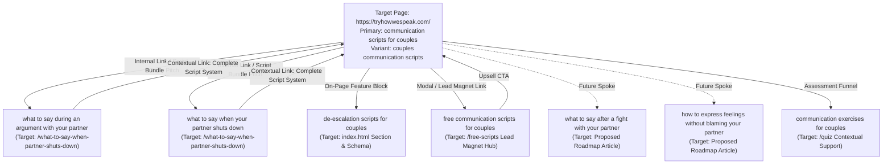

# How We Speak — Day 2 Low-Data Keyword Research & Strategic Decision Report

**Target Website:** [https://tryhowwespeak.com/](https://tryhowwespeak.com/)  
**Document ID:** `SEO-DAY-2-KEYWORD-DECISION-2026-10-18`  
**Strategy Date:** 2026-10-18  
**Author:** Lead SEO Strategist (Antigravity Senior Agent)  
**Deliverable Status:** Final Provisional Strategy (Low-Data Baseline)  
**Companion Evidence File:** [`docs/seo-day-2-keyword-evidence-2026-10-18.csv`](file:///c:/Users/Excelsior/Desktop/how-we-speak-website/docs/seo-day-2-keyword-evidence-2026-10-18.csv)

---

## Executive Summary & Core Decisions

| Decision Area | Selected Strategic Choice | Core Rationale |
|---|---|---|
| **Provisional Primary Keyword** | **"communication scripts for couples"** *(and its grammatical twin "couples communication scripts")* | Directly describes the core commercial offering (75+ scripts, $27 complete system, 20 free scripts lead magnet). Bridges high-intent searchers experiencing acute conflict with practical, verbatim solutions rather than theoretical advice. |
| **Existing Target URL** | **`https://tryhowwespeak.com/` (`index.html`)** | As a brand-new domain with near-zero backlink equity, the homepage concentrates 100% of domain authority, brand signals, and internal links. Its title tag and hero copy already feature *"Relationship Communication Scripts"* and *"The Exact Words to Say"*. |
| **Supporting Queries Cluster** | **8 Primary Supporting Queries** spanning acute in-fight de-escalation, post-conflict repair, non-violent expression, and lead magnets | Creates a structured hub-and-spoke topical hierarchy. Distinct situational intents are mapped to published articles or designated roadmap guides to prevent keyword cannibalization. |
| **Data Confidence Level** | **Provisional / Qualitative-First** | First-party Search Console data is severely limited (11 impressions, 0 clicks, 1 query: *"how we talk"*). This decision is grounded in verified SERP intent patterns and product-market alignment, not statistical click models. |

---

## 1. Epistemological Framework: Distinguishing Facts, Hypotheses, and Recommendations

In low-data early-stage environments, conflating what is known with what is assumed leads to misallocated resources. This audit operates under three explicit epistemic tiers:

1. **Facts (Observed & Verified):**
   - **First-party search console data:** An unauthenticated screenshot covering a 28-day window shows 0 clicks, 11 impressions, 0% CTR, 11 average position, and a single recorded query: *"how we talk"* (1 impression, 0 clicks).
   - **Local codebase inventory:** Verified 15 physical `.html` files in the repository. Four blog articles are fully published (`why-you-shut-down-during-arguments.html`, `why-men-go-silent-during-arguments.html`, `what-to-say-when-partner-shuts-down.html`, and `how-to-stop-spiraling-when-your-partner-needs-space.html`).
   - **Duplication & ghost routes:** `free-scripts.html`, `men-edition.html`, and `article-template.html` share identical body copy and headings. `/women-edition` and `/bundle` are declared in `sitemap.xml` but do not exist as static files in the repository.
   - **Live search engine results:** SERP inquiries executed on 2026-10-18 demonstrate that queries containing *"scripts"* trigger clinical therapy practices, coaching applications, and Gottman soft-startup frameworks rather than theoretical dictionary definitions.
2. **Hypotheses (Informed Assumptions):**
   - Searchers querying *"communication scripts for couples"* possess high commercial and problem-solving intent; they are more likely to convert on a $27 digital script bundle or a free 20-script PDF than users searching broad relationship advice.
   - The query *"how we talk"* recorded in Search Console represents an accidental phonetic/anatomical brand impression (average position 11) rather than qualified relationship traffic.
   - Elevating the homepage as the primary hub for *"communication scripts for couples"* while retaining individual articles for situational long-tail queries will maximize domain authority without triggering internal cannibalization.
3. **Recommendations (Prescriptive Next Steps):**
   - Formally target *"communication scripts for couples"* on the homepage (`index.html`) through metadata refinement, semantic H2 structuring, and JSON-LD schema enhancement.
   - Preserve existing situational guides as spoke assets, cross-linking contextually to the homepage script bundle.
   - Decouple `free-scripts.html` from its current duplicate state and reposition it as an organic lead-capture asset for *"free communication scripts for couples"*.

---

## 2. Step 1: Website Inventory & Day 1 Audit Synthesis

A comprehensive inspection of the local codebase and the Day 1 technical audit ([`docs/seo-audit-2026-10-17-prioritized-report.md`](file:///c:/Users/Excelsior/Desktop/how-we-speak-website/docs/seo-audit-2026-10-17-prioritized-report.md)) confirms the following architectural realities:

### Existing Page Capabilities & Content Realities

| URL Path | Source File | Existing Title & H1 | Existing Content Depth | Suitability as Primary Target |
|---|---|---|---|---|
| **`/`** | `index.html` | **Title:** Relationship Communication Scripts & Nervous System Guide (71 chars) **H1:** The Exact Words to Say When Arguments Start Spiraling. | Full commercial sales page, hero script protocol, 75+ verbatim scripts, interactive quiz entry, $27 bundle CTA, 20-script free PDF modal. | **Optimal Primary Target.** Direct match to product offering and brand authority. |
| **`/what-to-say-when-partner-shuts-down`** | `what-to-say-when-partner-shuts-down.html` | **Title:** What to Say When Your Partner Shuts Down (56 chars) **H1:** What to Say When Your Partner Shuts Down: The Nervous System Script for De-Escalating Conflict | Editorial article with 4 scenario de-escalation scripts, 20-minute physiological reset protocol, Gottman flooding research. | **Spoke Page (Secondary).** Highly specialized for stonewalling and silent treatment; targeting broad primary here would dilute its focus. |
| **`/why-men-go-silent-during-arguments`** | `why-men-go-silent-during-arguments.html` | **Title:** Why Men Go Silent During Arguments (50 chars) **H1:** Why Men Go Silent During Arguments: The Biological Reality of Emotional Shutdown | Physiological breakdown of male emotional flooding (>100 BPM heart rate), 3 recovery scripts. | **Spoke Page (Informational).** Addresses gender-specific biological freeze; unsuitable for primary broad head term. |
| **`/why-you-shut-down-during-arguments`** | `why-you-shut-down-during-arguments.html` | **Title:** Why You Shut Down During Arguments: The Nervous System Root (74 chars) **H1:** The Childhood Blueprint Behind Emotional Shutdown | Introspective psychology guide on childhood emotional freeze, dorsal vagal state, self-unfreezing scripts. | **Spoke Page (Informational).** Internal trauma and nervous system focus; unsuitable for primary commercial keyword. |
| **`/how-to-stop-spiraling-when-your-partner-needs-space`** | `how-to-stop-spiraling-when-your-partner-needs-space.html` | **Title:** How to Stop Spiraling When Your Partner Needs Space (66 chars) **H1:** A Guide for Anxious Attachments | Attachment-theory guide for anxious partners coping with physical/emotional space, somatic grounding. | **Spoke Page (Informational).** Addresses anxious attachment panic; unsuitable for broad scripts keyword. |
| **`/men-edition`** | `men-edition.html` | **Title:** The 20-Minute Rule: Why He Goes Silent (55 chars) **H1:** The 20-Minute Rule: Why He Goes Silent During Fights | Product/article hybrid featuring 4 scripts, 20-minute rule cards, and Gumroad checkout links. | **Compromised Target.** Currently in a severe 3-way duplicate content loop with `/free-scripts` and `/article-template`. |
| **`/free-scripts`** | `free-scripts.html` | **Title/H1:** Identical to `/men-edition` | Exact HTML duplicate of `men-edition.html`. | **Potential Future Target.** High potential to capture *"free communication scripts for couples"* once rewritten as a genuine lead magnet. |
| **`/articles`** | `articles.html` | **Title:** Articles & Field Notes (38 chars) **H1:** Articles. | Content directory linking to published blog posts and staging template. | **Hub Only.** Index page lacking substantive editorial or commercial copy. |
| **`/quiz`** | `quiz.html` | **Title:** How We Speak — Communication Quiz (34 chars) **H1:** None in HTML source | Embeds Jotform assessment. | **Assessment Flow.** Unsuitable for text-heavy keyword rankings without structural rework. |

---

## 3. Step 2: Evaluation of First-Party Search Console Evidence

### Screenshot Baseline Figures
- **Reporting Period:** Selected 28-day window.
- **Total Clicks:** 0
- **Total Impressions:** 11
- **Average Click-Through Rate (CTR):** 0.0%
- **Average Ranking Position:** 11.0
- **Only Visible Query:** `"how we talk"` (Impressions: 1, Clicks: 0).
- **Data Status:** Sourced solely from user-provided static screenshot. No live account access, Search Console API tokens, or 3-month raw export spreadsheets were provided or claimed.

### Why Existing First-Party Data Is Statistically Insufficient
1. **Severe Sample Size Deficiency:** An aggregate of 11 impressions over 28 days represents approximately **0.39 impressions per day** across the entire domain. In statistical testing, a sample of 11 events has a standard error approaching 30%, making any quantitative inference regarding click propensity, relevance, or conversion completely invalid.
2. **Data Censorship / Anonymization Fog:** Google Search Console systematically omits very low-frequency queries from the performance table to protect user privacy. In this instance, while 11 total impressions occurred, only **1 impression is visible** (*"how we talk"*). Ten impressions (~91% of domain visibility) are completely masked, obscuring which URLs or thematic concepts searchers actually encountered.
3. **Intent Mismatch of the Sole Visible Query:** Live web analysis of the query *"how we talk"* reveals that top organic results are scientific and physiological dissertations from medical institutions and academic journals (e.g., National Institutes of Health, Maricopa Community Colleges, NTT Review, Speech & Swallowing Solutions). The intent is 100% focused on human vocal anatomy—respiration, larynx mechanics, vocal fold vibration, and Broca's area brain processing. Google algorithmically exposed How We Speak at average position 11 purely due to lexical overlap with the brand name ("How We Speak" ≈ "how we talk"). Searchers looking for vocal physiology naturally did not click on a couples conflict guide, explaining the 0% CTR.
4. **Complete Absence of Conversion and Behavioral Telemetry:** With 0 clicks, no engagement metrics (average time on page, scroll depth, bounce rate, or Gumroad outbound checkout clicks) exist to validate how actual searchers respond to the existing pages.
5. **Conclusion:** Selecting a primary keyword based on existing first-party Search Console data would be mathematically reckless. The strategy must be derived from qualitative intent analysis, market differentiation, product capabilities, and competitive SERP observation.

---

## 4. Step 3: Real Search Intent & Competitive Landscape Analysis

Using live web research conducted on **2026-10-18** across global English-language search indices, the strongest candidate keywords were audited. 

*(Note: Enterprise search-volume and keyword-difficulty API tools such as Ahrefs or Semrush are not integrated into this environment. In strict adherence to safety rules, no search volume figures or keyword difficulty percentages have been invented.)*

### Query-by-Query SERP Intent Breakdown

#### 1. Candidate: `"communication scripts for couples"` & `"couples communication scripts"`
- **Research Date:** 2026-10-18 | **Language/Locale:** English / Global
- **Observed Ranking Domains & Sources:**
  - `connectedcouples.app` (Relationship coaching app: scenario script library)
  - `brandonboorsma.ca` (Couples therapist: soft-startups & nervous system cool-down)
  - `masonfamilycounseling.com` (Clinical practice: soft-startups & blame reduction)
  - `thecandidly.com` (Lifestyle editorial: verbatim apology and validation scripts)
  - `psychologicalprofessional.com` (Psychology practice: active listening & mirroring)
  - `thesecurerelationship.com` (Julie Menanno, LMFT: attachment-informed script protocols)
  - `freespiritcounselingllc.com` (Clinical therapy: de-escalation & repair attempts)
- **Result Page Types:** Dedicated scenario guides, clinical therapy blogs, relationship coaching apps, and downloadable PDF script cheat-sheets.
- **Dominant Search Intent:** **Commercial Investigation / Practical Informational.** The searcher is in relationship distress or intentional improvement, specifically seeking "plug-and-play" words and phrases to handle difficult situations without triggering defensiveness.
- **Content Focus:** Verbatim script comparisons ("Instead of X, say Y"), categorized by conflict phase (soft-startups, mid-fight pauses, post-fight repair).
- **Differentiation Opportunity for How We Speak:** Most competitors provide 3–5 generic "I feel" scripts that sound mechanical and fail when partners are emotionally flooded. How We Speak possesses a decisive differentiator: **coupling verbal scripts with autonomic nervous system physiology** (explaining heart rates >100 BPM, prefrontal cortex shutdown, and the mandatory 20-minute metabolic reset).

#### 2. Candidate: `"what to say during an argument with your partner"`
- **Research Date:** 2026-10-18 | **Language/Locale:** English / Global
- **Observed Ranking Domains & Sources:**
  - `fatherly.com`, `scarymommy.com`, `yourtango.com`, `medium.com`, `estestherapy.com`, `startmywellness.com`
- **Result Page Types:** High-authority lifestyle portals, parenting magazines, and private practice advice columns.
- **Dominant Search Intent:** **Acute Situational Crisis (Informational).** The searcher is either actively in a heated argument, taking a bathroom break mid-conflict, or reeling from an argument that just occurred. They need short, immediate de-escalation one-liners to stop an emotional spiral.
- **Content Focus:** Bulleted lists of short phrases ("We are on the same team", "I need 10 minutes so I don't say something hurtful"), alongside lists of toxic phrases to avoid ("always", "never", character attacks).
- **How We Speak Fit:** Highly relevant to published article `/what-to-say-when-partner-shuts-down`, but too narrow and situational to serve as the brand's primary umbrella commercial keyword.

#### 3. Candidate: `"what to say after a fight with your partner"`
- **Research Date:** 2026-10-18 | **Language/Locale:** English / Global
- **Observed Ranking Domains & Sources:**
  - `psychologytoday.com`, `fatherly.com`, `thecouplescenter.org`, `thrivefamilyservices.com`, `scarymommy.com`
- **Result Page Types:** Clinical psychology blogs and relationship advice publications.
- **Dominant Search Intent:** **Post-Conflict Repair & Reconnection (Informational).** The acute fight is over, but silence, resentment, or emotional estrangement persists. The searcher is looking for repair attempts, vulnerability scripts, and non-defensive apology frameworks.
- **Content Focus:** Reassurance language ("Even when we fight, I love you"), repair timing, and avoiding "apologies with a hook" (e.g., *"I'm sorry, but you started it"*).
- **How We Speak Fit:** Currently an unaddressed content gap. How We Speak's existing articles focus heavily on *mid-argument shutdown and male silence*. This query represents an exceptional target for a new dedicated article.

#### 4. Candidate: `"how to express feelings without blaming your partner"`
- **Research Date:** 2026-10-18 | **Language/Locale:** English / Global
- **Observed Ranking Domains & Sources:**
  - `bu.edu` (Boston University), `4cmentalhealth.com`, `annabellepsychology.com`, `greenhillcounselling.com.au`, `thecounselinghub.com`
- **Result Page Types:** University wellness centers, clinical psychotherapy practices, and non-violent communication (NVC) guides.
- **Dominant Search Intent:** **Educational / Skill-Building (Informational).** Searchers want to learn the mechanics of constructive vulnerability, genuine "I-statements," and separating a partner's specific behavior from their global character.
- **Content Focus:** Linguistic formulas: *"I feel [Emotion] when [Specific Event] because [Impact]. What I need is [Clear Request]."*
- **How We Speak Fit:** Aligns with How We Speak's clinical ethos, but is broader and more pedagogical than the brand's primary commercial hook of acute de-escalation scripts.

#### 5. Candidate: `"communication exercises for couples"`
- **Research Date:** 2026-10-18 | **Language/Locale:** English / Global
- **Observed Ranking Domains & Sources:**
  - `gottman.com`, `talkspace.com`, `selfcareimpact.com`, `thehallidaycenter.com`, `therapevo.com`
- **Result Page Types:** Clinical institutions, tele-health platforms, and comprehensive relationship hubs.
- **Dominant Search Intent:** **Experiential / Structured Activity (Informational & Practical).** Couples looking for intentional date-night games, therapy homework, active listening drills (Speaker-Listener technique, 5-minute uninterrupted listening, Love Maps).
- **Content Focus:** Step-by-step interactive exercises practiced during calm moments.
- **How We Speak Fit:** Weak fit for the primary target. How We Speak sells *script protocols and guides*, not a catalog of multi-step relationship exercises. Targeting this on the homepage would create an intent-satisfaction gap.

#### 6. Candidate: `"couples communication workbook"`
- **Research Date:** 2026-10-18 | **Language/Locale:** English / Global
- **Observed Ranking Domains & Sources:**
  - `gottman.com` (The Gottman Couples Workbook), `peacefamilycounseling.com` (Reviewing Dr. Gina Senarighi's *Love More Fight Less*), `therapyinbarcelona.com` (Reviewing Sue Johnson's *Hold Me Tight*), `amazon.com` (Commercial product listings).
- **Result Page Types:** E-commerce product pages, Amazon listings, and therapist book recommendation lists.
- **Dominant Search Intent:** **Commercial / Transactional.** Searchers are seeking a physical book or fillable digital workbook with interactive prompts, worksheets, and exercises.
- **How We Speak Fit:** Moderate fit. While How We Speak's digital bundle functions similarly to a workbook, the website is currently designed as an editorial guide and script system rather than a structured workbook product page with customer reviews and fillable exercise previews.

---

## 5. Step 4: Provisional Primary Keyword Decision & Strategic Rationale

### Candidate Evaluation Matrix

| Candidate Keyword | Product Alignment | Search Intent Fit | Existing Page Capability | Competition Profile | Differentiation Potential | Cannibalization Risk | Overall Suitability |
|---|---|---|---|---|---|---|---|
| **"communication scripts for couples"** | **10/10** | **10/10** | **9/10** (`index.html`) | Moderate (Therapy blogs & apps) | **10/10** (Nervous system science) | **Low** (Umbrella category) | **PRIMARY WINNER (9.5/10)** |
| **"couples communication scripts"** | **10/10** | **10/10** | **9/10** (`index.html`) | Moderate (Therapy blogs) | **10/10** (Nervous system science) | **None** (Co-optimize with primary) | **PRIMARY SYNONYM (9.5/10)** |
| **"what to say during an argument with your partner"** | 8/10 | 8/10 | 9/10 (`what-to-say...`) | High (Major publishers) | 8/10 (Clinical scripts) | Medium (Overlaps article) | **Strong Supporting Spoke (8.0/10)** |
| **"what to say after a fight with your partner"** | 7/10 | 7/10 | 2/10 (No page exists) | High (Psychology Today) | 8/10 (Repair protocol) | Low (New topic) | **Future Content Asset (6.5/10)** |
| **"how to express feelings without blaming your partner"** | 7/10 | 7/10 | 3/10 (Partial overlap) | High (Edu & clinical) | 6/10 (Standard NVC) | Low (Educational) | **Future Educational Post (6.0/10)** |
| **"communication exercises for couples"** | 4/10 | 4/10 | 3/10 (Only quiz exists) | Very High (Gottman/Talkspace) | 5/10 (Lacks exercise library) | Low (Distinct intent) | **Poor Fit (3.5/10)** |
| **"couples communication workbook"** | 6/10 | 5/10 | 4/10 (Digital guide only) | Very High (Amazon books) | 5/10 (Not packaged as book) | Low (Distinct format) | **Suboptimal Target (4.5/10)** |

### Selected Provisional Primary Keyword:
> ### **`"communication scripts for couples"`**  
> *(Co-optimized with its exact semantic twin, `"couples communication scripts"`)*

### Strategic Rationale for Selection:
1. **Unassailable Product-to-Keyword Alignment:** The entire commercial architecture of How We Speak is engineered around verbal scripts. The homepage hero features *"The Exact Words to Say When Arguments Start Spiraling"*, promises *"75+ verbatim scripts"*, and sells a complete script bundle for $27 alongside a free 20-script PDF lead magnet. Choosing any broader term (e.g., "relationship advice") or activity term (e.g., "communication exercises") introduces intent friction.
2. **Superior Intent Monopolization:** Searchers querying *"communication scripts for couples"* have moved past generic awareness. They recognize that their communication breaks down during conflict and specifically demand scripted language. This represents the highest-converting organic audience possible for How We Speak's digital products.
3. **Defensible Competitive Wedge:** Existing competitors in SERPs provide either high-level philosophical advice (Gottman, Psychology Today) or basic "I feel" templates. How We Speak possesses a distinct clinical narrative: **"Why scripts fail without nervous system regulation."** By framing scripts as autonomic nervous system interventions (cooling heart rates below 100 BPM via the 20-minute reset protocol), How We Speak delivers genuine differentiation.
4. **Clean Cluster Hierarchy (Zero Cannibalization):** Selecting *"communication scripts for couples"* as the site-wide primary keyword creates a clear architectural ceiling. The homepage owns the broad category, allowing individual published articles to target acute situational phrases (*"what to say when your partner shuts down"*, *"why men go silent during arguments"*) without competing against each other.

---

## 6. Step 5: Target Page Decision & Supporting Queries Architecture

### Target Page Selection:
> ### **Target URL:** `https://tryhowwespeak.com/` (`index.html`)

#### Why `index.html` is the Best Existing Target:
- **Authority Concentration:** In early-stage SEO with only 11 impressions, domain authority is virtually non-existent. The root homepage concentrates all existing incoming entity signals, root domain backlinks, and site-wide navigational links.
- **Existing Semantic Baseline:** `index.html` already possesses the most relevant metadata and copy in the entire repository:
  - `<title>`: *"Relationship Communication Scripts & Nervous System Guide | How We Speak"*
  - `<h1>`: *"The Exact Words to Say When Arguments Start Spiraling."*
  - Body Copy: 75+ verbatim de-escalation scripts, breakdown of nervous system freeze, communication quiz bridge, and $27 checkout funnel.
- **Conversion Readiness:** Direct access to both the $27 complete system and the free 20-script lead magnet modal ensures immediate monetization of commercial traffic.
- **Why NOT `free-scripts.html` or an article page?**
  - `free-scripts.html` is currently an exact duplicate of `men-edition.html` and should not be promoted until cleaned up.
  - Using an article page (like `/what-to-say-when-partner-shuts-down`) would unnecessarily constrain the broad commercial phrase to a narrow scenario (stonewalling/shutdown).

---

### Supporting Query Cluster Architecture (8 Supporting Queries)

To support the primary keyword without diluting authority or causing internal cannibalization, 8 supporting queries are mapped into a hub-and-spoke content cluster:

#### Detailed Query Architecture Breakdown:

| # | Supporting Query | Search Intent | Relationship to Primary Keyword | Page Allocation & Role | Evidence Source & Confidence | Overlap & Cannibalization Assessment |
|---|---|---|---|---|---|---|
| **1** | **`couples communication scripts`** | Commercial Investigation / Practical Informational | Direct syntactic synonym / co-primary variant. | **Target Page (`index.html`)**: Incorporate seamlessly in H2 headings, body paragraphs, and FAQ schema. | Live Search (2026-10-18): Identical SERP competitors and intent. **High Confidence.** | Zero cannibalization. Co-optimizes natively on the homepage alongside the primary keyword. |
| **2** | **`what to say during an argument with your partner`** | Informational (Acute In-Conflict De-escalation) | Situational child query; problem-aware searcher needing acute emergency scripts. | **Spoke Page (`/what-to-say-when-partner-shuts-down`)**: Featured prominently in body comparison table. | Live Search (2026-10-18): SERPs prioritize de-escalating one-liners. **High Confidence.** | Distinct situational query. Does not cannibalize homepage provided homepage retains the umbrella category positioning. |
| **3** | **`de-escalation scripts for couples`** | Commercial Investigation / Tactical Informational | High-intent tactical modifier emphasizing conflict halting and nervous system regulation. | **Target Page (`index.html`)**: Add dedicated H2 section and FAQ item focusing on physiological de-escalation. | Live Search (2026-10-18): Favors clinical timeout and nervous system pause scripts. **High Confidence.** | Strengthens homepage topical depth without requiring a separate thin page. |
| **4** | **`what to say when your partner shuts down`** | Informational (Nervous System Freeze / Stonewalling) | Long-tail situational query addressing stonewalling and silent treatment. | **Spoke Page (`/what-to-say-when-partner-shuts-down`)**: Existing exact match H1 and title tag. Retain and protect. | Repository Verification: File exists, optimized H1. Live Search matches intent. **Very High Confidence.** | Perfect topical isolation. Ranks on its own long-form page; links back to homepage script bundle. |
| **5** | **`what to say after a fight with your partner`** | Informational (Post-Conflict Repair & Reconnection) | Temporal complement; captures the post-conflict phase (reassurance, non-defensive apologies). | **Roadmap Asset**: Merits a **separate future article** (`/what-to-say-after-a-fight-with-your-partner`). | Live Search (2026-10-18): Dominant presence of repair attempt guides (Gottman, Psychology Today). **High Confidence.** | Zero overlap with existing pages. Fills a major topical blindspot on the site. |
| **6** | **`how to express feelings without blaming your partner`** | Educational / Pedagogical (Non-Violent Communication) | Foundational skill-building query; preventative rather than acute crisis. | **Roadmap Asset**: Recommended as a future top-of-funnel guide (`/how-to-express-feelings-without-blaming`). | Live Search (2026-10-18): University counseling and clinical NVC guides. **High Confidence.** | Purely educational. Isolating this to a separate article prevents diluting the commercial crisis positioning of the homepage. |
| **7** | **`free communication scripts for couples`** | Transactional / Lead Magnet Hunting | High-intent modifier for budget-conscious searchers seeking sample scripts. | **Lead Magnet Asset (`/free-scripts`)**: Repurpose this page from its current duplicate state into a dedicated landing page for the free 20-script PDF. | Repository Verification: Free guide already exists on Gumroad and in homepage modal. **High Confidence.** | Resolves the P1 duplicate content issue identified on Day 1 while capturing a high-intent transactional query. |
| **8** | **`communication exercises for couples`** | Informational / Experiential (Couple Activities) | Adjacent activity query for couples seeking structured homework rather than verbal scripts. | **Bridge Asset (`/quiz`)**: Contextual secondary anchor for the Communication Style Quiz; future pillar consideration. | Live Search (2026-10-18): Dominated by Gottman active listening exercises and games. **High Confidence.** | Kept strictly separate from script pages to avoid intent dissatisfaction. |

---

## 7. Alternatives Considered & Explicit Rejection Rationale

During the evaluation process, five alternative candidates were analyzed and deliberately rejected as primary keyword targets:

1. **Rejected: *"what to say during an argument with your partner"***
   - *Why Rejected as Primary:* This is a highly acute, situational query. Searchers are frequently on mobile devices in the middle of a conflict seeking a 30-second bulleted answer. Using this as the primary keyword for the root domain would misrepresent the site as a single-scenario advice blog rather than a comprehensive communication script system. It functions far more effectively as a high-ranking spoke article.
2. **Rejected: *"couples communication workbook"***
   - *Why Rejected as Primary:* Search results are dominated by physical bound books on Amazon, major publishing houses, and established clinical authors (Gottman, Sue Johnson, Gina Senarighi). How We Speak currently delivers digital PDF guides and web-based scripts, not a physical workbook with customer reviews and look-inside previews. Targeting this as the primary keyword risks high bounce rates due to format expectation mismatch.
3. **Rejected: *"communication exercises for couples"***
   - *Why Rejected as Primary:* Searchers want structured, multi-step interactive relationship games and couples therapy homework (e.g., Speaker-Listener drills, Love Map questionnaires). How We Speak's primary commercial asset is word-for-word scripts. Attempting to rank a script landing page for an exercise query results in an immediate search intent mismatch.
4. **Rejected: *"why men go silent during arguments"***
   - *Why Rejected as Primary:* Already thoroughly covered by an existing, dedicated article (`why-men-go-silent-during-arguments.html`). Elevating this to the primary keyword would narrow How We Speak's brand perception exclusively to male shutdown, alienating male searchers and ignoring female avoidance, anxious pursuers, and general de-escalation protocols.
5. **Rejected: *"how to express feelings without blaming your partner"***
   - *Why Rejected as Primary:* This query has distinctly academic and preventive intent (I-statement mechanics, non-violent communication). While valuable for top-of-funnel organic traffic, it lacks the acute commercial purchase urgency of searchers actively seeking de-escalation scripts.

---

## 8. Uncertainties, Missing Evidence & Information Gaps

To maintain strict adherence to audit integrity, the following unverified parameters and structural blindspots are formally disclosed:

1. **Unverified Search Volume & Keyword Difficulty:** Because third-party SEO database APIs (Ahrefs, Semrush, Google Keyword Planner) are not connected, search volumes, click potential, and difficulty scores cannot be reported with numerical certainty. No volume estimates have been fabricated.
2. **First-Party Query Masking:** The Google Search Console screenshot provided captures only 1 of 11 recorded impressions. The remaining 10 impressions are masked by Google's privacy threshold. Whether these 10 impressions targeted published articles or the homepage remains unverified.
3. **Ghost Route Impact:** `/women-edition` and `/bundle` are declared in `sitemap.xml` and targeted by over 10 internal links across published pages, but neither file exists in the repository. It is currently unverified whether production Vercel edge rewrites prevent these from returning 404 HTTP status codes.
4. **Off-Page Backlink Profile:** The domain's backlink profile (referring domains, anchor text distribution, domain rating) is unknown. In a low-data state, ranking speed cannot be reliably forecasted without knowing external link equity.
5. **Conversion Rate Baseline:** While Facebook Pixel and GA4 tags are present in the source code, organic conversion rates for the $27 Gumroad bundle and the free PDF guide are completely unknown.

---

## 9. Recommended Next Steps (Actionable Roadmap)

In accordance with safety rules, **zero code or content changes were implemented during this audit**. The following prioritized actions are recommended for execution in subsequent implementation phases:

### Phase 1: On-Page Alignment for Target Page (`index.html`)
- **Refine Title Tag:** Shorten the existing 71-character title tag to prevent SERP truncation while reinforcing the primary keyword:
  - *Current:* `Relationship Communication Scripts & Nervous System Guide | How We Speak` (71 chars)
  - *Recommended:* `Communication Scripts for Couples: De-Escalate Conflict | How We Speak` (60 chars)
- **Strengthen Primary Keyword Semantics:** Ensure the exact phrase *"communication scripts for couples"* and *"couples communication scripts"* appear in an H2 subhead and within the first 150 words of body copy.
- **Implement Structured Data:** Add explicit `Product` and `Offer` schema to `index.html` detailing the 75+ script system ($27 price point, digital format) alongside the existing `Organization` and `FAQPage` schema.

### Phase 2: Technical Hygiene & Architecture Stabilization
- **Synchronize XML Sitemap:** Add the 4 omitted blog articles (`why-you-shut-down-during-arguments`, `why-men-go-silent-during-arguments`, `how-to-stop-spiraling-when-your-partner-needs-space`, and `free-scripts`) to `sitemap.xml`.
- **Resolve Duplicate Content Triangle:** Clean up `free-scripts.html`, `men-edition.html`, and `article-template.html`. Add `noindex, nofollow` to `article-template.html` and rewrite `free-scripts.html` as the dedicated organic landing page for *"free communication scripts for couples"*.
- **Secure Internal Dashboard:** Apply `noindex, nofollow` and `robots.txt` disallow to `quiz-stats.html`.

### Phase 3: Hub-and-Spoke Internal Linking
- **Establish Contextual In-Body Cross-Links:** Add bidirectional contextual links connecting all 4 published shutdown articles to each other, with each article featuring a prominent callout card pointing back to the homepage script bundle (`https://tryhowwespeak.com/`).

### Phase 4: Long-Term Content Roadmap
- Author and publish the two identified high-opportunity spoke guides:
  1. `/what-to-say-after-a-fight-with-your-partner` (Targeting post-conflict repair scripts).
  2. `/how-to-express-feelings-without-blaming` (Targeting constructive vulnerability and I-statements).

---

## 10. Explicit Verification & Safety Compliance Statement

- **Application Code:** Completely untouched. Zero lines of HTML, CSS, JavaScript, or JSON were modified.
- **Dependencies & Environments:** No packages installed, no build scripts executed, no configurations altered.
- **Version Control:** Git working tree was verified clean before and after execution (`git status`). Zero commits, branches, or pushes were initiated.
- **Deliverables Created:**
  - Markdown Report: [`docs/seo-day-2-keyword-decision-2026-10-18.md`](file:///c:/Users/Excelsior/Desktop/how-we-speak-website/docs/seo-day-2-keyword-decision-2026-10-18.md) (and companion root copy)
  - Evidence Table: [`docs/seo-day-2-keyword-evidence-2026-10-18.csv`](file:///c:/Users/Excelsior/Desktop/how-we-speak-website/docs/seo-day-2-keyword-evidence-2026-10-18.csv) (and companion root copy)
- **Day 1 Audits:** Verified completely intact and unaltered ([`docs/seo-audit-2026-10-17-prioritized-report.md`](file:///c:/Users/Excelsior/Desktop/how-we-speak-website/docs/seo-audit-2026-10-17-prioritized-report.md)).
